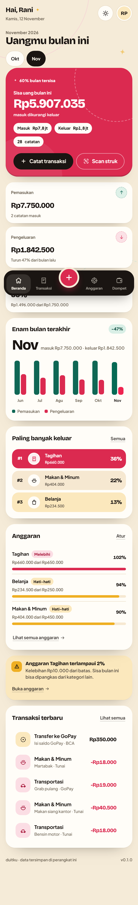
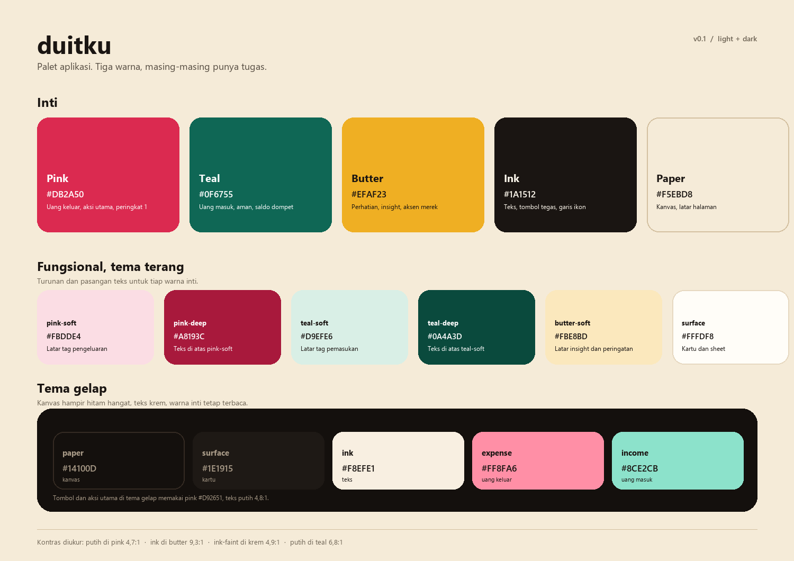

# duitku

Pencatat keuangan harian yang berjalan di browser. Catat pengeluaran, baca nominal dari QR struk, atur anggaran per kategori, dan lihat ke mana uang pergi. Semua data tersimpan di `localStorage`, tanpa server dan tanpa akun terpusat.

Prototype fungsional, dibuat berdasarkan `USER-FLOWS.md` dan referensi visual dari soal.



## Menjalankan

```bash
npm install --ignore-scripts
npm run dev
```

Buka `http://127.0.0.1:5173`.

Catatan: di mesin ini pemasangan paket harus memakai `--ignore-scripts` karena kebijakan keamanan memblokir proses postinstall. Skrip itu tidak dibutuhkan karena bundler memakai binari esbuild yang sudah disertakan.

Perintah lain:

| Perintah | Fungsi |
|---|---|
| `npm run dev` | Server pengembangan di port 5173, rebuild otomatis saat file berubah |
| `npm run build` | Cek tipe lalu hasilkan `dist/` siap statis |
| `npm run typecheck` | `tsc --noEmit` |
| `npm run qr` | Buat ulang `public/contoh-struk-qr.png` untuk demo scanner |

## Akun demo

| Email | Password |
|---|---|
| `demo@duitku.id` | `duitku123` |

Data contoh dibuat deterministik: enam bulan transaksi, tiga dompet, lima anggaran dengan status aman, hati-hati, dan melebihi.

## Peta fitur ke USER-FLOWS.md

| Use case | Status | Catatan |
|---|---|---|
| UC-01 Registrasi, UC-02 Login, UC-03 Logout | Ada | Lokal, satu perangkat |
| UC-04 Ubah profil | Sebagian | Nama bisa diubah, password belum |
| UC-05 Hapus akun | Ada | Wajib mengetik `HAPUS` |
| UC-10 Tambah transaksi | Ada | Format ribuan, simpan dan tambah lagi, peringatan anggaran |
| UC-11 Lihat, cari, filter | Ada | Filter di URL, dikelompokkan per tanggal, pagination 20 |
| UC-12 Ubah, UC-13 Hapus dan urungkan | Ada | Urungkan 8 detik |
| UC-14 Ekspor CSV | Ada | Mengikuti filter aktif, BOM UTF-8, sel formula dinetralkan |
| UC-15 Isi dari struk | Ada, versi QR | QR dibaca di browser dengan jsQR, bukan OCR teks |
| UC-20 sampai UC-23 Kategori | Ada | Bawaan hanya bisa disembunyikan, kategori terpakai dipindahkan |
| UC-30 sampai UC-33 Dashboard | Ada | Ringkasan, ganti bulan, tren enam bulan, Top 3, insight |
| UC-40 sampai UC-43 Anggaran | Ada | Ambang 80 persen dan 100 persen, salin dari bulan lalu |
| UC-50 sampai UC-52 Dompet dan transfer | Ada | Transfer satu transaksi, saldo dua dompet, tolak saldo kurang |
| UC-80 Tema | Ada | Terang, gelap, sistem |
| UC-81 Ekspor semua data | Ada | JSON, bukan ZIP berisi CSV |
| UC-60/61 Transaksi berulang, UC-70 target tabungan, UC-90 PWA | Belum | Di luar lingkup prototype ini |

## Arsitektur

```
src/
  main.tsx, App.tsx          rute, tema, guard sesi, sheet catat global
  lib/
    types.ts                 model data
    db.ts                    penyimpanan, validasi, aksi, hook useDB/useUser
    seed.ts                  data demo deterministik
    derive.ts                ringkasan bulanan, tren, status anggaran, insight
    format.ts                rupiah, tanggal Asia/Jakarta, bulan
    csv.ts                   CSV dan ekspor JSON
    qr.ts                    decode QR dan parsing nominal
    useCountUp.ts            animasi angka hero
    hash.ts                  digest password khusus demo
  components/                shell, sheet, toast, grafik, baris transaksi, ikon, error boundary
  pages/                     Auth, Dashboard, Transactions, Budgets, Wallets, Categories, Scan, Settings
  styles/                    tokens, base, ui, pages
scripts/                     dev server esbuild, build, verifikasi browser, generator QR
```

Bundler memakai esbuild langsung (bukan Vite) karena binari native rollup diblokir kebijakan Application Control di mesin ini. Server pengembangan hanya menyajikan `dist/` dengan fallback SPA, jadi tautan seperti `/transactions?month=2026-11` tetap bekerja saat di-refresh.

### Model data

`User`, `Wallet`, `Category`, `Transaction` (expense, income, transfer), `Budget`, semuanya berkunci `userId`. Saldo dompet = saldo awal + pemasukan - pengeluaran + transfer masuk - transfer keluar. Transfer tidak dihitung sebagai pemasukan atau pengeluaran.

## Desain

Arah visual mengikuti referensi: kanvas krem, blok warna tebal, sudut besar, angka display besar, dan aksen coretan. Detail lengkap ada di [DESIGN.md](DESIGN.md).

Palet lengkap, termasuk token tema gelap dan rencana palet maskot, ada di [docs/palette.md](docs/palette.md).



Ringkas:

- Tiga warna punya tugas, bukan hiasan. Pink berarti uang keluar, teal uang masuk, butter butuh perhatian.
- Huruf Bricolage Grotesque untuk angka dan judul, Plus Jakarta Sans untuk teks antarmuka. Plus Jakarta Sans digambar di Jakarta, cocok dengan bahasa produk.
- Motif berulang: gelang putus-putus di sekitar angka, sparkle sebagai penanda bagian, tombol pil dan kartu bersudut 26 sampai 34 piksel.

## Aksesibilitas dan ketahanan

- Fokus keyboard terlihat di semua kontrol, dialog mengunci fokus, `Escape` menutup, fokus kembali ke pemicu.
- Target sentuh minimal 44 piksel untuk tombol, chip, dan aksi baris.
- Kontras teks dicek pada tema terang dan gelap.
- Setiap halaman punya satu `h1`, landmark `header`, `nav`, `main`, `footer`, dan judul dokumen per rute.
- Ada empty state, skeleton loading, dan pesan gagal untuk daftar serta grafik.
- `prefers-reduced-motion` mematikan animasi.

## Verifikasi

`node scripts/verify.mjs` menjalankan Chrome headless lewat DevTools Protocol dan menguji 31 skenario: login demo, tambah transaksi, simpan, filter URL, hapus dan urungkan, ubah transaksi, transfer dengan saldo kurang, decode QR contoh, tema gelap, focus otomatis, Escape, penyimpanan penuh, 404, redirect saat keluar, dan overflow di 360 piksel. Skrip butuh Chrome dengan port debug 9333 dan server dev yang berjalan.

Hasil terakhir: 30 dari 30 lulus, tanpa error konsol, pada build pengembangan dan produksi.

## Batasan dan catatan

- Ini penyimpanan lokal, bukan aplikasi bank. Tidak ada enkripsi, tidak ada sinkronisasi, dan tidak ada isolasi data antar pengguna seperti pada server. Digest password hanya penghalang demo.
- Nama "Duitku" sudah dipakai gateway pembayaran yang cukup dikenal di Indonesia. Ganti nama sebelum dipublikasikan.
- Ikon aplikasi dan avatar adalah placeholder: huruf `d` untuk merek, inisial nama untuk avatar. Belum ada logo final.
