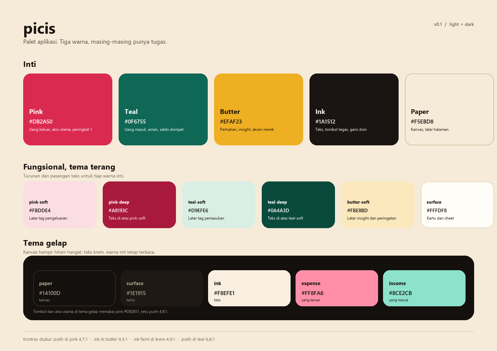
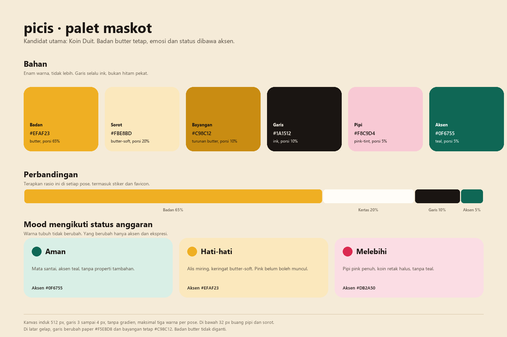

# Palet warna picis

Sumber kebenaran ada di `src/styles/tokens.css`. Lembar gambar dihasilkan dari file itu oleh `scripts/make-palette-sheet.py`.





## 1. Palet aplikasi

Tiga warna inti, masing-masing memegang satu arti. Netral (paper, ink, surface) tidak dihitung sebagai warna inti.

### Tema terang

| Token | Hex | Dipakai untuk |
|---|---|---|
| `--paper` | `#F5EBD8` | Kanvas halaman |
| `--paper-deep` | `#EDDFC4` | Kanvas saat butuh lapisan lebih dalam |
| `--surface` | `#FFFDF8` | Kartu, sheet, input |
| `--surface-2` | `#FBF1DF` | Isian input, baris hover |
| `--surface-3` | `#F6E8D1` | Track progres, baris peringkat 2 |
| `--ink` | `#1A1512` | Teks utama, tombol tegas, garis ikon |
| `--ink-soft` | `#574E43` | Teks sekunder |
| `--ink-faint` | `#6E6455` | Label kecil, keterangan |
| `--line` | `#E6D8C0` | Garis tipis |
| `--line-strong` | `#D3C0A0` | Garis putus-putus, batas kosong |
| `--pink` | `#DB2A50` | Uang keluar, aksi utama, peringkat 1 |
| `--pink-deep` | `#A8193C` | Teks di atas pink-soft |
| `--pink-soft` | `#FBDDE4` | Latar tag pengeluaran |
| `--pink-tint` | `#F8C9D4` | Pipi maskot, sorotan lembut |
| `--teal` | `#0F6755` | Uang masuk, aman, saldo dompet |
| `--teal-deep` | `#0A4A3D` | Teks di atas teal-soft |
| `--teal-soft` | `#D9EFE6` | Latar tag pemasukan |
| `--teal-tint` | `#B9E0D3` | Busur latar |
| `--butter` | `#EFAF23` | Perhatian, insight, aksen merek |
| `--butter-soft` | `#FBE8BD` | Latar peringatan dan insight |

### Tema gelap

| Token | Hex | Dipakai untuk |
|---|---|---|
| `--paper` | `#14100D` | Kanvas |
| `--surface` | `#1E1915` | Kartu |
| `--surface-2` | `#251F1A` | Isian dan hover |
| `--surface-3` | `#2C241D` | Track dan panel ringan |
| `--ink` | `#F8EFE1` | Teks utama |
| `--ink-soft` | `#CFC2B1` | Teks sekunder |
| `--ink-faint` | `#A99B88` | Label kecil |
| `--line` | `#352B23` | Garis tipis |
| `--pink` | `#D92651` | Isian tombol dan aksi utama di tema gelap |
| `--pink-deep` | `#FF8FA6` | Teks pink di permukaan gelap |
| `--pink-soft` | `#3A1220` | Latar tag merah muda |
| `--teal` | `#177A64` | Tombol teal |
| `--teal-deep` | `#8CE2CB` | Teks teal di permukaan gelap |
| `--teal-soft` | `#0F2E27` | Latar tag hijau |
| `--butter` | `#EFAF23` | Tetap sama, sudah kontras |
| `--butter-soft` | `#3A2C0D` | Latar insight |
| `--expense` | `#FF8FA6` | Angka pengeluaran |
| `--income` | `#8CE2CB` | Angka pemasukan |

### Aturan pakai

1. Warna inti hanya tiga. Jangan menambah biru, ungu, atau oranye baru. Kalau butuh variasi, ambil tint atau shade dari tiga warna itu.
2. Warna membawa arti, bukan dekorasi. Pink selalu uang keluar atau aksi utama. Teal selalu uang masuk atau aman. Butter selalu perhatian.
3. Pasangan wajib: `soft` untuk latar, `deep` untuk teks di atasnya, warna inti untuk isian dan angka besar.
4. Teks normal minimal 4,5:1. Jangan taruh teks putih di atas butter atau paper.
5. Jangan pakai hitam murni `#000000` atau putih murni `#FFFFFF` untuk teks. Pakai ink dan on-ink.
6. Tanpa gradien, tanpa glow. Kedalaman hanya dari bayangan tipis dan garis tepi.

### Kontras terukur

| Pasangan | Rasio |
|---|---|
| Putih di `--pink` terang `#DB2A50` | 4,71:1 |
| Putih di `--pink` gelap `#D92651` | 4,83:1 |
| Putih di `--teal` `#0F6755` | 6,79:1 |
| `--ink` di `--butter` | 9,33:1 |
| `--ink` di `--paper` | 15,31:1 |
| `--ink-faint` di `--paper` | 4,91:1 |
| `--ink-soft` di `--surface` | 8,02:1 |
| `--pink-deep` di `--surface` | 7,20:1 |
| `--teal-deep` di `--surface` | 10,03:1 |
| `--ink` gelap di `--surface` gelap | 15,29:1 |
| `--ink-faint` gelap di `--surface` gelap | 6,42:1 |

Catatan revisi: pink tema gelap semula `#E0305A`, hanya 4,43:1 dengan teks putih. Digelapkan ke `#D92651` supaya lolos 4,83:1, dan teks pink di permukaan gelap sekarang memakai `--pink-deep` `#FF8FA6` yang mencapai 8,08:1.

## 2. Palet maskot

Kandidat utama: **Koin Duit**, koin bulat dengan dua mata dan alis sederhana. Alasan: cocok dengan tema uang, bentuknya tetap terbaca di 24 piksel, dan warnanya bisa memakai butter tanpa merusak keseimbangan tiga warna aplikasi.

Alternatif: **Celengan**, bentuk babi celengan yang lebih Indonesia. Bahan warnanya sama, hanya proporsinya berubah.

### Bahan

Enam warna, tidak lebih. Rasio ini berlaku di setiap pose, termasuk stiker dan favicon.

| Peran | Hex | Porsi | Catatan |
|---|---|---|---|
| Badan | `#EFAF23` | 65% | Butter. Identitas maskot, tidak diganti per mood |
| Sorot | `#FBE8BD` | 20% | Butter-soft, di sisi kiri atas saja |
| Bayangan | `#C98C12` | 10% | Turunan butter, bukan hitam |
| Garis | `#1A1512` | 10% | Ink, bukan hitam pekat. 3 sampai 4 px di kanvas 512 |
| Pipi | `#F8C9D4` | 5% | Pink-tint, opsional, dibuang di bawah 32 px |
| Aksen | `#0F6755` | 5% | Teal, untuk status aman dan properti kecil |

### Mood mengikuti status anggaran

Warna tubuh tidak pernah berubah. Yang berubah hanya aksen dan ekspresi, supaya maskot tetap dikenali.

| Status | Aksen | Ekspresi |
|---|---|---|
| Aman | `#0F6755` teal | Mata santai, tanpa properti tambahan |
| Hati-hati | `#EFAF23` butter | Alis miring, keringat butter-soft, belum ada pink |
| Melebihi | `#DB2A50` pink | Pipi pink penuh, koin retak halus, tanpa teal |

### Aturan gambar

1. Maksimal tiga warna per pose. Badan, garis, dan satu aksen. Sorot dan bayangan dihitung sebagai turunan badan.
2. Tanpa gradien, tanpa tekstur, tanpa bayangan jatuh di dalam badan. Sorot berupa bidang datar.
3. Di latar gelap, garis berubah menjadi `#F5EBD8` dan bayangan tetap `#C98C12`. Badan butter tidak diganti.
4. Di bawah 32 piksel, buang pipi dan sorot. Sisakan badan butter dan garis ink.
5. Mata dan mulut selalu garis ink. Highlight mata memakai `#FFF9EE`, bukan putih murni.
6. Maskot tidak boleh menjadi satu-satunya penanda status. Warna tetap ditemani teks status yang sudah ada.

### Token siap tempel

```css
:root {
  --mascot-body: #efaf23;
  --mascot-highlight: #fbe8bd;
  --mascot-shade: #c98c12;
  --mascot-line: #1a1512;
  --mascot-blush: #f8c9d4;
  --mascot-accent: #0f6755;
  --mascot-accent-warn: #efaf23;
  --mascot-accent-over: #db2a50;
}

[data-theme='dark'] {
  --mascot-line: #f5ebd8;
}
```

### Format aset

| Ukuran | Pakai untuk |
|---|---|
| 512 px, SVG atau PNG transparan | Master, sheet merek |
| 128 px | Empty state dan ilustrasi kecil |
| 48 px | Toast dan badge |
| 24 sampai 32 px | Favicon dan ikon tab |

## 3. Yang belum dibuat

Belum ada gambar maskot. Palet di atas masih rencana warna. Setelah konsep dipilih, langkah berikutnya baru menggambar pose netral, senang, dan melebihi.
